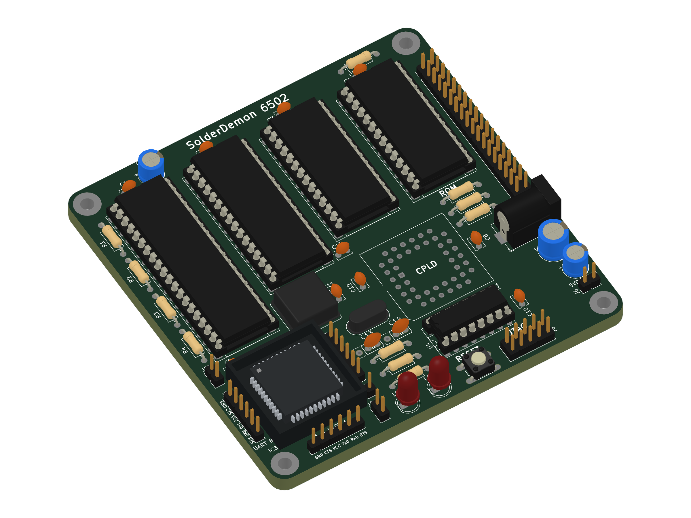
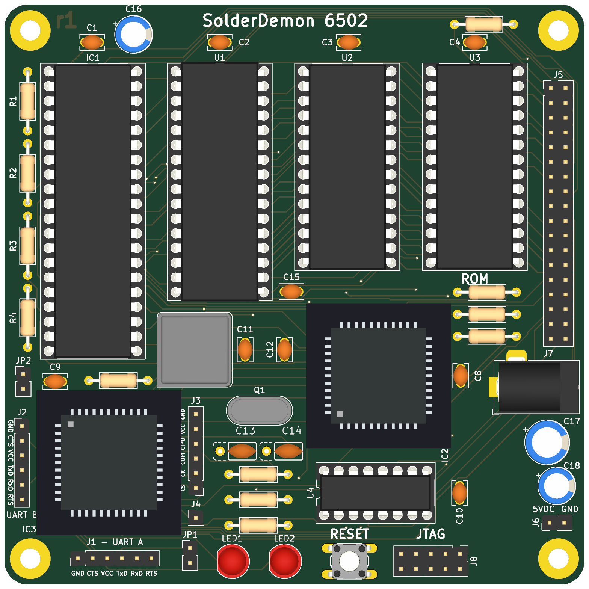
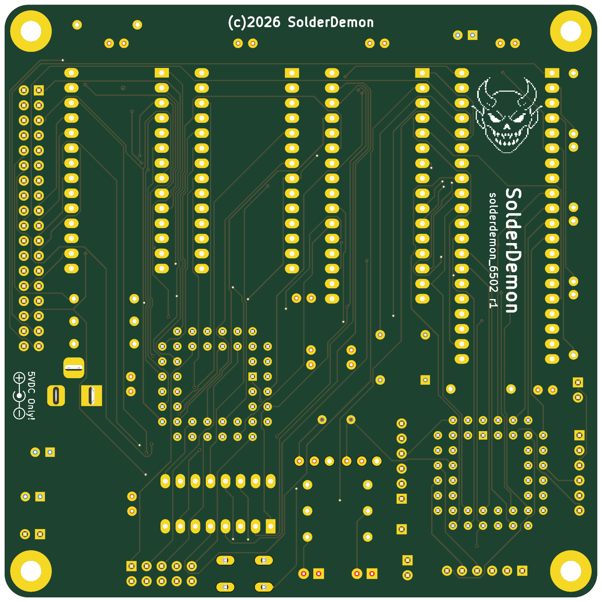

# SolderDemon 6502

Revision r1 — the first SolderDemon revision of this board.

## A 65C02 Single-Board Computer

SolderDemon 6502 is a programmable, extensible 8-bit retro computer built around the WDC 65C02,
and the mainboard of SolderDemon's 6502 line. This repository holds its design files, firmware
and software.

It is based on [rosco_6502](https://github.com/rosco-m68k/rosco_6502) (CERN OHL). r1 is rosco_6502 r4
with its glue logic moved into one ATF1502AS CPLD; it was developed here as "r5", and the
[revision notes](docs/revision-5.md) still use that name.

* All Software released under the MIT licence. See LICENSE for details.
* All Hardware released under the CERN Open Hardware licence. See LICENCE.hardware.txt.
* All Documentation released under Creative Commons Attribution. See <https://creativecommons.org/licenses/by/2.0/uk/>

| Top Side | Bottom Side |
|:---:|:---:|
|  |  |

## Documentation

Start with the [documentation index](docs/README.md).

* [Getting started and terminal setup](docs/getting-started.md)
* [Hardware and memory map](docs/hardware.md)
* [Building and programming ROM](docs/rom-firmware.md)
* [Building and programming PLDs](docs/pld-firmware.md)
* [Developing and loading programs](docs/software.md)
* [Troubleshooting](docs/troubleshooting.md)
* [Revision 4 notes](docs/revision-4.md)
* [SolderDemon 6502 r1 notes](docs/revision-5.md) (developed as r5)

## Specifications

### Hardware

The hardware specifications for the SolderDemon 6502 are:

* WDC 65C02 at up-to 14MHz (In theory, 10MHz testing target currently).
* SCN68681C1A44 provides two UARTs, timers and SD Card / SPI / GPIO; the console runs at 38400 bit/s
* 528KB RAM
  * 16KB low RAM ($0000 - $3FFF)
  * 16 x 32KB RAM banks ($4000 - $BFFF)
* 8KB IO space ($C000 - $DFFF)
* 8KB or 32KB (banked) ROM $E000 - $FFFF
* High-speed decode and glue logic handled by Atmel F22V10C PLDs (r4), or by a single ATF1502AS CPLD programmed in the board over JTAG (SolderDemon r1, see [r1 notes](docs/revision-5.md)).
* Comprehensive expansion and IO connectors allow the system to be easily expanded!

You can see the electrical designs in [kicad](design/kicad). Programmable logic lives in [pld](code/pld).

### Software

The current firmware uses the cc65 toolchain (`ca65`, `ld65` and `da65`).
It includes hardware initialization, WozMon, SD card access, read-only FAT32
support and boot code that looks for `/ROSC0DE_6502.BIN` on the SD card.
The firmware and filesystem utilities are still under development.

See the [firmware README](code/firmware/README.md) for build
instructions.

### Related tools

* [rosco CLI](https://github.com/solderdemon/rosco-cli): a cross-platform `rosco` command
  that creates, builds and uploads rosco_6502 (and rosco_m68k) programs over UART, or
  runs them in the emulator.
* [rosco-emulator](https://github.com/solderdemon/rosco-emulator): a slimmed-down MAME
  build that emulates the rosco_6502 r4, so programs and firmware can be tested without
  the board.

See [Developing and loading programs](docs/software.md#rosco-cli-and-emulator) for usage.

## Repository layout

* [design/kicad](design/kicad): board schematic and PCB layout (`solderdemon_6502` KiCad project).
* [design/CAMOutputs](design/CAMOutputs): Gerber and drill files for r1.
* [code/pld](code/pld): programmable logic sources.
* [tools](tools): scripts that derive the r1 schematic and board from rosco_6502 r4, add the SolderDemon identity and check the CPLD.
* [code/firmware](code/firmware): ca65 firmware and ROM linker configurations.
* [code/software](code/software): example programs, tests and filesystem utilities.
* [docs](docs): additional project documentation.

## License

* **Hardware:** CERN Open Hardware Licence v1.2 ([LICENCE.hardware.txt](LICENCE.hardware.txt)).
* **Copyright © 2026 SolderDemon.**
* Modified from rosco_6502 r4 (© 2022-2023 Ross Bamford & Contributors); the licences require
  that notice to stay in the design files and in [LICENSE](LICENSE).
