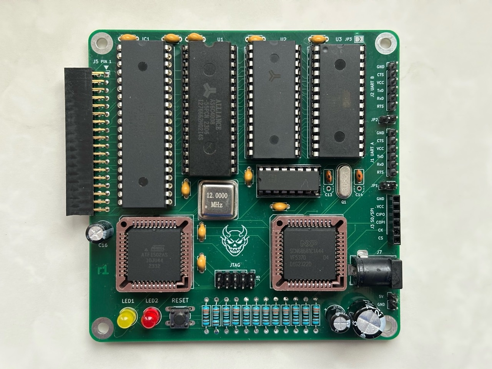
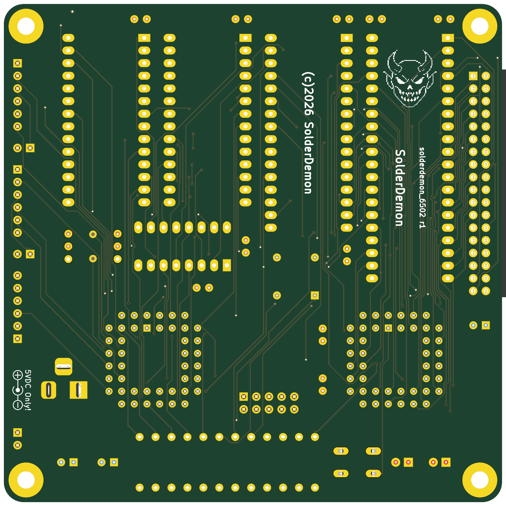

# SolderDemon 6502

Revision r1 — a 100 × 100 mm board. J5 stands beside the CPU; CPU, bank RAM, low RAM and ROM run side by side under the top edge, the CPLD and DUART sockets sit on one line below them with the SolderDemon logo and JTAG between, and the indicators, RESET and all resistors form the bottom row. Their references are on the component side. The UART and SD/SPI connectors are straight pin headers along the right edge. J5 is a right-angle socket on the left edge, so the host stands upright in the busboard's HOST slot; the standalone CS2 pin header is removed ([layout and mounting notes](docs/layout-r1.md)).

## A 65C02 Single-Board Computer

SolderDemon 6502 is a programmable, extensible 8-bit retro computer built around the WDC 65C02,
and the mainboard of SolderDemon's 6502 line. This repository holds its design files, firmware
and software.

It is based on [rosco_6502](https://github.com/rosco-m68k/rosco_6502) (CERN OHL). r1 is rosco_6502 r4
with its glue logic moved into one ATF1502AS CPLD; it was developed here as "r5", and the
[revision notes](docs/revision-5.md) still use that name.

| Top Side | Bottom Side |
|:---:|:---:|
|  |  |

## Start here

- [KiCad project](design/solderdemon_6502.kicad_pro)
- [Schematic (PDF)](manufacturing/solderdemon_6502-schematic.pdf)
- [Gerbers and drill files](manufacturing/solderdemon_6502-r1-gerbers.zip)
- [Getting started](docs/getting-started.md)

## Documentation

Start with the [documentation index](docs/README.md).

* [Getting started and terminal setup](docs/getting-started.md)
* [Hardware and memory map](docs/hardware.md)
* [Building and programming ROM](docs/rom-firmware.md)
* [Building and programming PLDs](docs/pld-firmware.md)
* [Developing and loading programs](docs/software.md)
* [Troubleshooting](docs/troubleshooting.md)
* [Revision 4 notes](docs/revision-4.md)
* [SolderDemon 6502 r1 notes](docs/revision-5.md) (developed as r5)
* [SolderDemon 6502 r1 layout](docs/layout-r1.md)

## Specifications

### Hardware

The hardware specifications for the SolderDemon 6502 are:

* WDC 65C02 at up-to 14MHz (In theory, 10MHz testing target currently).
* SCN68681C1A44 provides two UARTs, timers and SD Card / SPI / GPIO; the console runs at 38400 bit/s
* 528KB RAM
  * 16KB low RAM ($0000 - $3FFF)
  * 16 x 32KB RAM banks ($4000 - $BFFF)
* 8KB IO space ($C000 - $DFFF)
* 8KB or 32KB (banked) ROM $E000 - $FFFF
* High-speed decode and glue logic handled by Atmel F22V10C PLDs (r4), or by a single ATF1502AS CPLD programmed in the board over JTAG (SolderDemon r1, see [r1 notes](docs/revision-5.md)).
* Comprehensive expansion and IO connectors allow the system to be easily expanded!

You can see the electrical designs in [kicad](design). Programmable logic lives in [pld](code/firmware/pld).

### Software

The current firmware uses the cc65 toolchain (`ca65`, `ld65` and `da65`).
It includes hardware initialization, WozMon, SD card access, read-only FAT32
support and boot code that looks for `/ROSC0DE_6502.BIN` on the SD card.
The firmware and filesystem utilities are still under development.

See the [firmware README](code/firmware/README.md) for build
instructions.

### Related tools

* [rosco CLI](https://github.com/solderdemon/rosco-cli): a cross-platform `rosco` command
  that creates, builds and uploads rosco_6502 (and rosco_m68k) programs over UART, or
  runs them in the emulator.
* [rosco-emulator](https://github.com/solderdemon/rosco-emulator): a slimmed-down MAME
  build that emulates the rosco_6502 r4, so programs and firmware can be tested without
  the board.

See [Developing and loading programs](docs/software.md#rosco-cli-and-emulator) for usage.

## Licences and attribution

- **Hardware:** [CERN Open Hardware Licence v1.2](LICENCE.hardware.txt).
- **Software:** [MIT](LICENSE).
- **Documentation:** [Creative Commons Attribution 2.0 UK](https://creativecommons.org/licenses/by/2.0/uk/).

Based on [rosco_6502](https://github.com/rosco-m68k/rosco_6502) r4, © 2022–2023 Ross Bamford & Contributors. SolderDemon changes include the CPLD glue logic, r1 board layout and build documentation. Copyright © 2026 SolderDemon. Original authorship and licence notices are retained.

<!-- repository-layout -->
## Repository layout

- [`design/`](design/solderdemon_6502.kicad_pro) holds the KiCad project, schematic, PCB and local libraries.
- [`code/firmware/`](code/firmware/) — ROM and programmable-logic sources and programming files.
- [`code/software/`](code/software/) — Example programs and filesystem utilities.
- [`code/build/`](code/build/) — Local build products.
- [`tools/`](tools/) — Design generators and verification.
- [`manufacturing/`](manufacturing/) — Fabrication files and schematic PDF.
- [`images/`](images/) — Board views and artwork.

Open the project in `design/`. Use the scripts in `tools/` to change the design. The `.kicad_pro` file holds the DRC rules.
The r1 placement scripts are in `tools/`. To rebuild the reviewed 5.08 mm capacitor
placement from `design/placement_before_5mm_caps.kicad_pcb.gz`, run
`tools/upgrade_100nf.py`, then `tools/route_r5.py` to redraw the signal tracks.
<!-- /repository-layout -->

## Design history

The r4 import and the initial CPLD design are retained as generator inputs. See the upstream rosco_6502 repository for the original development history.

The USB-Blaster patch applies to the OpenOCD 0.12.0 driver under the GNU GPL.
See [the GPL text](licenses/GPL-2.0.txt) and [OpenOCD](https://github.com/openocd-org/openocd/tree/v0.12.0).
