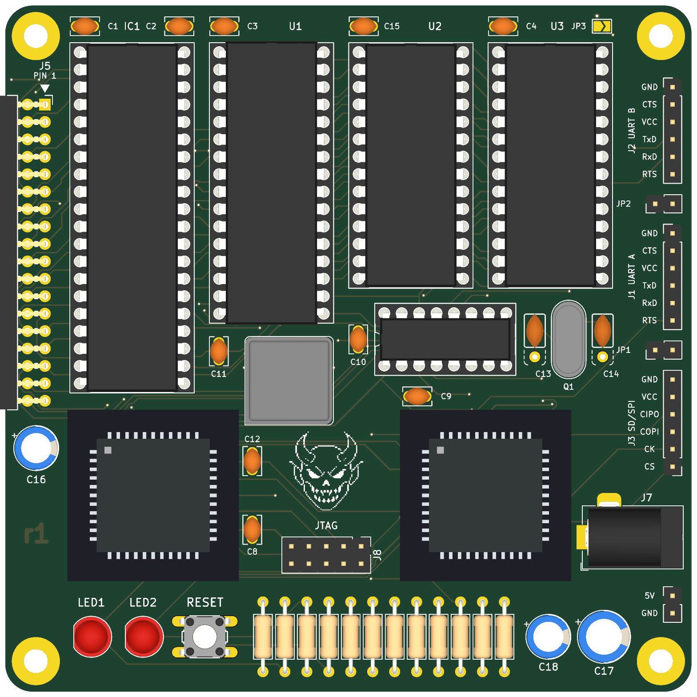

# SolderDemon 6502 r1 layout

[Documentation index](README.md)

This is the SolderDemon 6502 revision 1 board. The outline is 100 × 100 mm, with J5, the left datum and the mounting holes where the busboard expects them.

The parts stand in four bands, top to bottom:

| Band | Parts |
|---|---|
| DIP row | CPU (IC1), bank RAM (U1), low RAM (U2) and ROM (U3) side by side, pin 1 up, 20.32 mm apart on the 2.54 mm grid of J5's pins. Each has its decoupling capacitor over it; the ROM's jumper JP3 is beside its capacitor. |
| Under the DIPs | the CPU oscillator X1 under U1; the bank register U4 and the DUART crystal Q1 between its two 7 pF capacitors under U2 and U3 |
| Socket row | CPLD (IC2) under the CPU and DUART (IC3) on one line, both with pin 1 at the upper-left corner; the SolderDemon logo and JTAG header J8 sit between them |
| Bottom row | LED1, LED2 and RESET under the CPLD, all twelve resistors in one row, the bulk capacitors C18 and C17. Each R reference is printed inside its resistor outline on the component side. |

The UART B (J2), UART A (J1) and SD/SPI (J3) straight pin headers, the power jack J7 and the 5 V header J6 run down the right edge. Each UART's supply jumper is under its header. The bulk capacitor C16 stands under J5, with the copper revision mark below it. The front silkscreen labels the two indicators simply LED1 and LED2. J4, the standalone CS2 pin header, is removed from the schematic, PCB and BOM; the DUART SPICS2 signal remains in the design.



## J5 and the busboard

J5 keeps the busboard pin order. Its pin 1 is at (5.775, 14.425) mm from the board's top-left corner, on the inner row beside the CPU; pin 2 lies 2.54 mm toward the edge. The footprint is `solderdemon_6502:PinSocket_2x18_P2.54mm_Horizontal_EdgeMount` (`tools/make_r1_pcb.py`, `edge_socket()`): KiCad's stock right-angle 2×18 socket, whose pads are exactly the stock header mirrored about pin 1's column, with the silkscreen clipped at the board edge. The housing overhangs the left edge by about 6.7 mm; fab, courtyard and the 3D model are the stock ones.

Fit a **right-angle female 2×18 socket** here and stand the board upright in the busboard's HOST slot, component side toward the busboard's left edge, pin 1 at the busboard's top edge; the socket alone carries the board, so fix the busboard to a case or base first. `PIN 1` and a triangle are printed over the socket, since it hides the square pad, and the busboard repeats the pin 1 triangle beside every slot. Expansion cards copy J5's position, so every board on the busboard faces the same way. Do not run a ribbon cable from these pads to the busboard: with pin 2 inboard of pin 1, a plain 36-way ribbon to the straight HOST header swaps every odd/even pair and puts VCC on A0. The mating model (contact-row heights, edge height, clearances to the neighbouring slot and the corner hardware) is in the busboard's `BACKPLANE.md`.

The busboard has 20 mm slot pitch. The host has 16 mm to the busboard's edge; SLOT 1 sees only its solder side.

The r1 PCB uses four copper layers and a nominal 1.6 mm FR-4 stackup. The VCC and GND internal
planes stop 0.6 mm inside the outline; the KiCad copper-to-edge rule is 0.5 mm. Both PLCC-44
sockets face the same way. Rotating IC2 to match IC3 required a fresh signal route; the completed
board has no unconnected pads or error-severity DRC findings with schematic parity.

## Rebuild

```sh
K="/c/Program Files/KiCad/10.0/bin"
"$K/python.exe" tools/make_r1_pcb.py
"$K/python.exe" tools/make_logo.py 11.5
"$K/python.exe" tools/brand_r1.py
"$K/python.exe" tools/route_r5.py
"$K/kicad-cli.exe" sch erc -o design/erc-r1.rpt design/solderdemon_6502.kicad_sch
"$K/kicad-cli.exe" pcb drc --schematic-parity -o design/drc-r1.rpt design/solderdemon_6502.kicad_pcb
"$K/python.exe" tools/export_manufacturing.py   # Gerbers, drills and design/solderdemon_6502-r1-gerbers.zip
```

`make_r1_pcb.py` checks component courtyard overlaps and board-edge containment before routing. The KiCad project file is retained for DRC settings.
